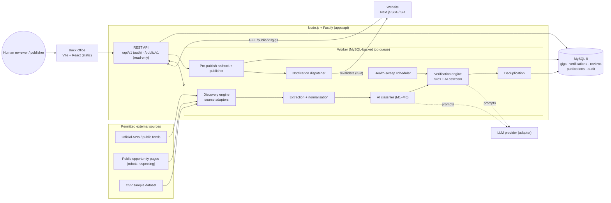
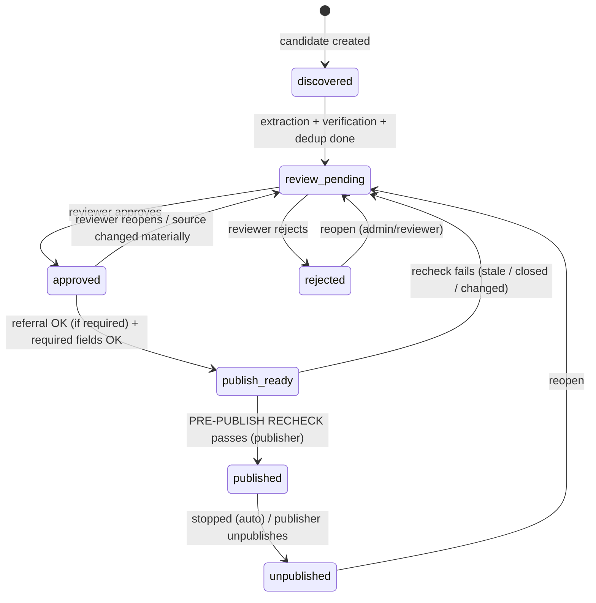
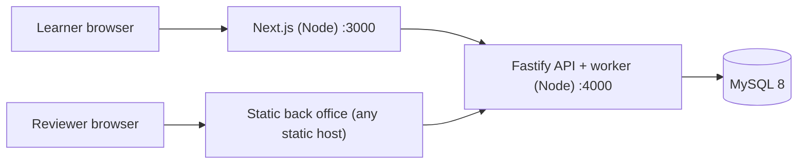

# Architecture

## 1. System context



## 2. Components & responsibilities

| Component | Responsibility | Key rules |
|---|---|---|
| **Source adapters** (`apps/api/src/sources/*`) | One module per source implementing `search()`, `fetchDetail()`, `healthCheck()` | Added/removed without touching core (maintainability NFR). Must declare access method; refuse restricted content |
| **Extraction/normalisation** | Raw → internal gig model → 19-column fields | Missing = `NULL`, never invented. Original payment text kept in `payment_source_text` |
| **Classifier** | Proposes M1–M6 with confidence and rationale | Below `classification.confidence_min` → `track_id = NULL`, "manual classification" |
| **Verification engine** | URL check → opportunity match → availability signal → status + confidence + evidence | Evidence-based, not HTTP 200. Hybrid rules + AI (see §4) |
| **Deduplicator** | external id → normalised URL → content similarity | Same id/URL ⇒ update/version; similarity ⇒ *flag*, never silently merge |
| **Review service** | Edit / approve / reject / pause / stop / reopen / referral | Every action writes `reviews` + `audit_log` |
| **Publisher** | Gate → pre-publish recheck → snapshot → publish → notify | Only human-approved; atomic transaction |
| **Notification dispatcher** | Webhook / email / in-app events with retries | Learner events only for genuinely published gigs |
| **Job queue** | `jobs` table, `SELECT … FOR UPDATE SKIP LOCKED` | No Redis; failure of one gig/source never aborts the run |
| **Back office** | Review queue, detail, evidence viewer, sources, runs, CSV, publish, audit | RBAC-aware UI; no secrets |
| **Website** | Opportunities listing/search/detail via SSG + ISR | Reads **only** `/public/v1`; revalidated on publish/unpublish |

## 3. Pipeline (sequence)

```mermaid
sequenceDiagram
  autonumber
  participant Adm as Admin/Scheduler
  participant API as Fastify API
  participant W as Worker
  participant Src as Source adapter
  participant AI as LLM
  participant DB as MySQL
  Adm->>API: POST /discovery/runs
  API->>DB: insert discovery_runs(queued) + job
  API-->>Adm: 202 {runId}
  W->>DB: claim job (SKIP LOCKED)
  W->>Src: search(criteria) [rate-limited, robots-checked]
  loop each candidate (isolated try/catch)
    W->>Src: fetchDetail(url)
    W->>W: extract + normalise (NULL if unknown)
    W->>DB: dedup lookup (external id → URL hash → similarity)
    alt exists
      W->>DB: version + pending_source_changes (human-edited fields protected)
    else new
      W->>AI: classify (M1–M6)
      W->>AI: assess availability (page text only)
      W->>W: validate AI quotes exist verbatim in page; compute confidence
      W->>DB: gig(review_pending) + verification + evidence
    end
    Note over W,DB: on error → discovery_errors row, continue
  end
  W->>DB: run status = succeeded | partial | failed
```

## 4. Verification decision logic

1. **Reachability** (permitted method only): status, final URL, restriction flag (login / CAPTCHA / paywall / robots / rate-limit → *skip, flag, `needs_review`*; never bypass).
2. **Entity match**: page/API record title ≈ extracted title (guards against redirects to generic pages).
3. **Availability signals** (deterministic first): closed/expired/"no longer accepting"/404/410 → *closed*; "paused/waitlist/temporarily unavailable/not accepting right now" → *paused*; apply button/"accepting"/open task count → *open*.
4. **AI assessor** receives only extracted page text and returns JSON `{signal, quotes[], reasoning}`. Each quote must exist **verbatim** in the fetched text or it is discarded (anti-hallucination). AI output is stored as `is_ai_generated = 1` evidence, separate from extracted facts.
5. **Score**: weighted (reachability 0.15, entity match 0.25, explicit availability signal 0.40, evidence freshness 0.10, rules↔AI agreement 0.10).
6. **Decision**
   * `Active` only if explicit *open* signal **and** confidence ≥ `verification.confidence_active_min`.
   * `Stopped` only on explicit closed marker or 404/410 (a timeout is **not** "stopped").
   * `Paused` on explicit paused marker.
   * Anything else, conflict between rules and AI, restricted content or confidence < `confidence_review_below` ⇒ `Needs Review`.
7. A **human-set** status (`availability_set_by = 'human'`) is never silently overwritten by a later automated check; conflicts are surfaced to the reviewer.

## 5. Gig workflow state machine


Availability (`active | paused | stopped | needs_review`) is an independent axis: *Stopped* or *Rejected* can never be published; *Paused/Needs Review* cannot pass the publish gate.

## 6. Publish gate (all must be true)
1. `workflow_state` is `approved`/`publish_ready` **and** `approved_by` set (DB CHECK + app).
2. Pre-publish verification run **now** (≤ `publish.recheck_max_age_minutes`) with result `active`.
3. Required fields present: `title`, `track_id`, `short_description`, `overview`, `origin_url`.
4. Referral present if `sources.referral_required` (or global default) is true ⇒ else "missing referral" state.
5. Not an open suspected duplicate; role is `publisher`/`admin` (optionally ≠ approver).
6. Single DB transaction: insert `publications` (with snapshot + verification id) → set `published` → enqueue notifications → after commit, call website revalidate. Any failure ⇒ `publications.status='failed'`, admin notification, nothing public.

## 7. Defence in depth (DB-level)
`CHECK`: approved states need approver; published publication needs verification + publisher; sources can't be enabled without access method + terms review; `robots_respected = 1`. Triggers: publish guard; no false learner notification. Unique keys: `(source_id, external_gig_id)`, URL hash, one active referral per gig/source.

## 8. Deployment view

