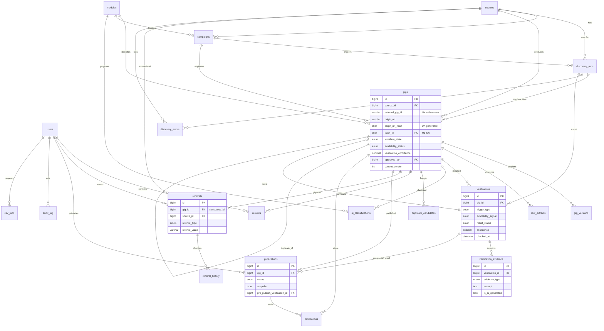

# Database ERD & Data Dictionary (MySQL 8)

22 tables + 2 views, created by `db/migrations/001–009`. **Validated**: applied up → down → up on MySQL 8.0.46.

## 1. ER diagram

## 2. Tables by area

| Area | Tables | Purpose |
|---|---|---|
| Identity | `users` | admin / reviewer / publisher accounts |
| Reference | `modules` (M1–M6, seeded), `settings` | module catalogue, tunable thresholds |
| Sources | `sources`, `campaigns` | access method, ToS review, health, referral-required flag; search criteria |
| Discovery | `discovery_runs`, `discovery_errors`, `raw_extracts` | per-run counts/status; failures per stage; sanitised raw source content (retention-limited) |
| Core | `gigs`, `gig_versions`, `duplicate_candidates` | the 19 CSV fields + workflow; full snapshots per change; dedup flags |
| Verification & AI | `verifications`, `verification_evidence`, `ai_classifications` | every check (incl. pre-publish), evidence rows, AI proposals |
| Review | `reviews`, `referrals`, `referral_history` | reviewer actions with before/after; human-entered referral + trail |
| Publishing | `publications`, `notifications` | what went live (exact snapshot) and events about it |
| Ops | `audit_log`, `csv_jobs`, `jobs` | who/when for everything; import/export reports; DB-backed queue |
| Views | `v_published_gigs`, `v_gig_csv_export` | public read model; exact 19-column export |

## 3. Requirement → schema traceability

| FRD | Where satisfied |
|---|---|
| SRC-01…05 | `sources` (access_method, health, enablement, terms_reviewed_at), `campaigns`, `gigs.source_id/campaign_id` |
| DISC-04 | `gigs.posted_at` (DATE, NULL) + `posted_at_status` (`found`/`not_found`) |
| DISC-07 | `gigs.data_completeness`, `discovery_errors`, `discovery_runs.status='partial'` |
| VER-01…07 | `verifications` (reachability, signal, status, confidence, checked_at), `verification_evidence`, `gigs.last_verified_at` |
| VER-05 | `payment_amount` + `payment_source_text` + numeric min/max/currency |
| DED-01…04 | `uq_gigs_source_external`, `uq_gigs_url_hash`, `content_fingerprint`, `duplicate_candidates`, `gig_versions` |
| AI traceability | `ai_generated_fields`, `field_provenance`, `evidence.is_ai_generated`, `ai_classifications` |
| REV-01…08 | `reviews`, `gigs.workflow_state`, evidence tables |
| REF-01…04 | `referrals`, `referral_history`, `sources.referral_required` |
| PUB-01…05 | `chk_gigs_publish_needs_approval`, `publications` (+`chk_pub_published_has_proof`), `trg_gigs_publish_guard` |
| NOT-01…03 | `notifications` (+`trg_notifications_no_false_publish`) |
| DB-05 | `audit_log`, `reviews`, `referral_history`, `gig_versions` |

## 4. Data dictionary – `gigs` (CSV contract columns)

| Column | Type | Null | Notes |
|---|---|---|---|
| external_gig_id | VARCHAR(191) | Y | stable id from source; UK with `source_id` |
| title | VARCHAR(255) | Y* | *required to publish |
| track_id | CHAR(2) FK modules | Y* | M1–M6; *required to publish; NULL = manual classification |
| payment_amount | VARCHAR(120) | Y | e.g. `$45 / hr` |
| compensation_type | ENUM(hourly,fixed,per_task,monthly,other) | Y | NULL when unknown |
| min_amount / max_amount | DECIMAL(12,2) | Y | CHECK min ≤ max |
| currency | CHAR(3) | Y | ISO-4217, CHECK `[A-Z]{3}` |
| priority | INT | N (0) | higher = shown first |
| is_featured / is_local_business | TINYINT(1) | N (0) | booleans |
| posted_at | DATE | Y | NULL when source gives none (never invented) |
| origin_url | VARCHAR(2048) | N | required |
| short_description | VARCHAR(500) | Y* | *required to publish |
| overview | TEXT | Y* | *required to publish |
| responsibilities / deliverables / requirements / proof_spec | TEXT | Y | items joined by ` \| ` (see CSV contract) |

## 5. Migration list
`001` users, modules, sources, campaigns, runs · `002` gigs, versions, raw extracts, duplicates, errors · `003` verifications, evidence, AI classifications (+FK on gigs) · `004` reviews, referrals, history · `005` publications, notifications · `006` audit, settings, csv_jobs, jobs · `007` views · `008` seeds (modules, sources, settings) · `009` triggers.
